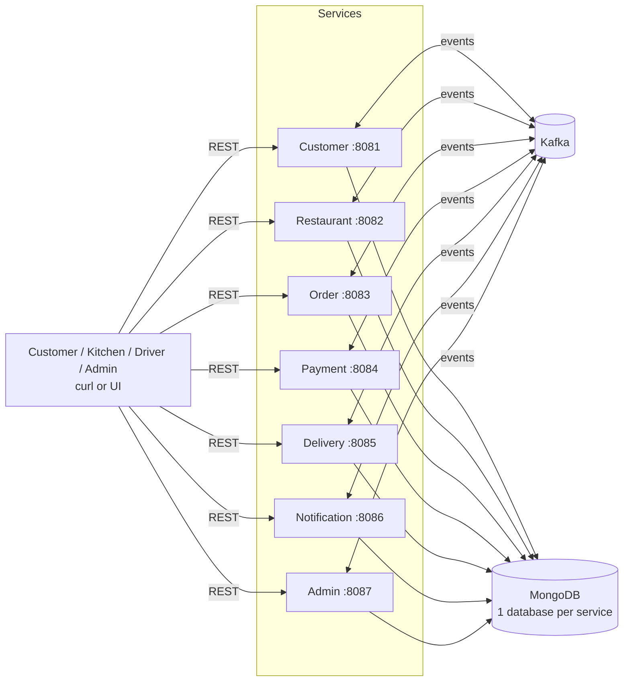
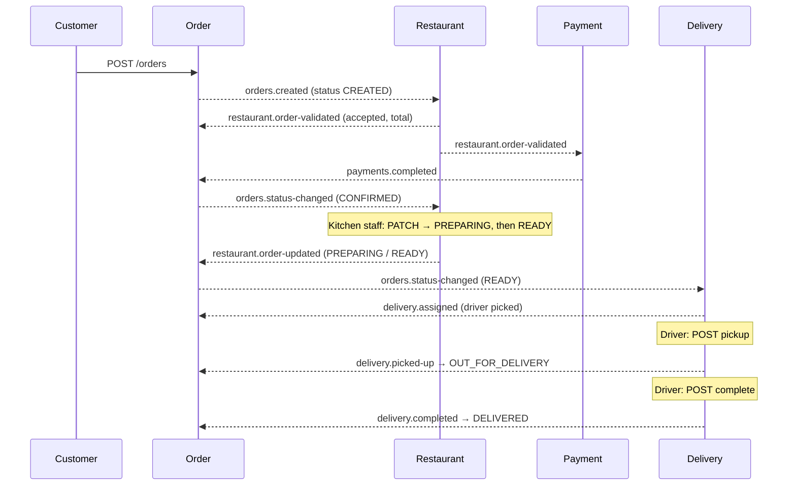

# 🍔 Distributed Food Delivery Platform — DSA612S Assignment 2

> **Due: Monday 05 October 2026, 23:59.** Commits after this are not accepted.
> **Rule from the brief:** 100% AI-generated code = **zero**. Every member writes their own code. Every member must appear in the commit log or they get **0**.

This README is the **contract**. If your code and this file disagree, **this file wins**. Want to change a contract (a topic, an event field, an endpoint)? Post it in the group chat first, update this README in its own commit, then change the code.

---

## Contents

1. [Tech stack](#1-tech-stack)
2. [Team and task split](#2-team-and-task-split)
3. [Repo structure](#3-repo-structure)
4. [Architecture and order flow](#4-architecture-and-order-flow)
5. [Kafka contract (topics and events)](#5-kafka-contract)
6. [Service contracts (endpoints, collections, functions)](#6-service-contracts)
7. [How to write code (conventions)](#7-how-to-write-code)
8. [Docker and running locally](#8-docker-and-running-locally)
9. [Git workflow](#9-git-workflow)
10. [Timeline](#10-timeline)
11. [Definition of done and demo script](#11-definition-of-done-and-demo-script)
12. [Bonus (only after the core works)](#12-bonus)
13. [Work log (who built what)](#13-work-log-who-built-what)

---

## 1. Tech stack

| Layer | Choice | Notes |
|---|---|---|
| Language | **Ballerina Swan Lake 2201.13.x** | Everyone uses the same version (`bal version`) |
| HTTP | `ballerina/http` | Each service has its own REST API |
| Messaging | **Apache Kafka 3.9** (KRaft, no Zookeeper) + `ballerinax/kafka` | All service-to-service communication goes through Kafka |
| Database | **MongoDB 7** + `ballerinax/mongodb` | One Mongo container, **one database per service** |
| IDs | `ballerina/uuid` | IDs are prefix + UUID, e.g. `ORD-3f2a…` |
| Time | `ballerina/time` | Every timestamp is ISO-8601 UTC: `time:utcToString(time:utcNow())` |
| Containers | **Docker + Docker Compose** | One `docker compose up` starts everything |
| Kafka viewer | `provectuslabs/kafka-ui` | For the live demo, so markers can watch events flow |
| Currency | NAD | |

**The golden rule:** a service **never** calls another service's REST API and **never** reads another service's database. Services only talk to each other through Kafka events. REST is only for users (customers, kitchen staff, drivers, admins).

---

## 2. Team and task split

Every member owns at least one service from start to finish: code, DB collections, Kafka producer/consumer, Dockerfile.

| Member (GitHub username) | Owns | Why this split |
|---|---|---|
| **Gavin** (`GavinK05`) | **Order Service** + this contract (README, `contracts/`) | Order is the core. Every event goes through it |
| Member 2 (`HeisLazi`) | **Restaurant Service** | Menus, stock, opening hours, kitchen queue |
| Member 3 (`Amaru-Jay`) | **Delivery Service** | Drivers, assignment, pickup and drop-off |
| Member 4 (`_____`) | **Payment Service** + **Notification Service** | Both are mostly Kafka consumers, so they're smaller |
| Member 5 (`_____`) | **Customer Service** + **Admin Service** + **Docker Compose / infra** | Customer and Admin are read models. Infra is 20% of the marks |

> 6+ members? Split off Notification, Admin and Docker as their own owners. Extra people then take a **bonus** (section 12).

**Shared work (everyone):** the architecture diagram (`docs/`), the demo run-through, and the presentation. **Everyone must be able to explain the full order flow in section 4**, because the markers can ask anyone.

---

## 3. Repo structure

```
food-delivery-platform/
├── README.md                  ← this contract
├── docker-compose.yml         ← all 7 services + kafka + mongo + kafka-ui
├── contracts/
│   ├── events.bal             ← Ballerina record types for every event (copy into your service)
│   └── samples/               ← one example JSON per topic (for testing)
├── infra/
│   └── kafka/create-topics.sh ← creates every topic with 3 partitions
├── services/
│   ├── customer-service/
│   ├── restaurant-service/
│   ├── order-service/
│   ├── payment-service/
│   ├── delivery-service/
│   ├── notification-service/
│   └── admin-service/
└── docs/
    ├── architecture.png
    └── demo.md
```

**Every service folder looks exactly the same:**

```
order-service/
├── Ballerina.toml
├── Config.toml          ← local values (localhost)
├── Config.docker.toml   ← docker values (kafka:29092, mongo:27017)
├── Dockerfile
├── WORKLOG.md           ← who built/tested each function (section 13)
├── main.bal             ← configurables, listeners, clients
├── types.bal            ← records and enums for this service + events copied from contracts/
├── service.bal          ← HTTP resources ONLY (thin: validate input → call logic → return)
├── logic.bal            ← business rules (state machine, calculations)
├── db.bal               ← ALL MongoDB calls
├── producer.bal         ← ALL Kafka publishing
└── consumer.bal         ← Kafka listener and event handlers
```

> Ballerina package names can't contain `-`. The folder is `order-service` and the package name in `Ballerina.toml` is `order_service`.

---

## 4. Architecture and order flow

### 4.1 System overview



### 4.2 The happy path (memorise this)



**Notification** and **Admin** listen to all of this in the background.

### 4.3 Order state machine (owned by the Order Service only)

| From | Allowed to | Triggered by |
|---|---|---|
| — | `CREATED` | `POST /orders` |
| `CREATED` | `CONFIRMED` | `payments.completed` |
| `CREATED` | `CANCELLED` | `restaurant.order-validated` (rejected), `payments.failed`, customer cancel |
| `CONFIRMED` | `PREPARING` | `restaurant.order-updated` (PREPARING) |
| `CONFIRMED` | `CANCELLED` | customer cancel, `restaurant.order-updated` (REJECTED) |
| `PREPARING` | `READY` | `restaurant.order-updated` (READY) |
| `READY` | `OUT_FOR_DELIVERY` | `delivery.picked-up` |
| `OUT_FOR_DELIVERY` | `DELIVERED` | `delivery.completed` |

Any other transition is **rejected**: HTTP `409` for REST, or log-and-skip for Kafka. `DELIVERED` and `CANCELLED` are final.

**Only the Order Service changes an order's status.** Other services publish *facts* ("payment done", "food ready") and the Order Service decides.

---

## 5. Kafka contract

### 5.1 Topic rules

- **Partitions:** 3 per topic. **Replication:** 1 (single broker).
- **Message key = `orderId`** on every topic. All events for one order land on the same partition, so they're processed **in order**.
- **Consumer group = the service name**, e.g. `payment-service`. Every service gets every event it subscribes to. If you start two copies of one service, they share the partitions.
- **Auto-create is OFF.** Topics are created by `infra/kafka/create-topics.sh`, so a typo in a topic name fails loudly.
- **Manual commit:** process the event, save to the DB, **then** commit the offset. That gives at-least-once delivery.
- **Idempotency:** every consumer saves handled `eventId`s and skips duplicates.

### 5.2 Topic list (9 topics)

| # | Topic | Producer | Consumers |
|---|---|---|---|
| 1 | `orders.created` | Order | Restaurant, Customer, Notification, Admin |
| 2 | `orders.status-changed` | Order | Restaurant, Delivery, Customer, Notification, Admin |
| 3 | `restaurant.order-validated` | Restaurant | Order, Payment, Notification |
| 4 | `restaurant.order-updated` | Restaurant | Order, Notification |
| 5 | `payments.completed` | Payment | Order, Notification, Admin |
| 6 | `payments.failed` | Payment | Order, Notification, Admin |
| 7 | `delivery.assigned` | Delivery | Order, Notification, Admin |
| 8 | `delivery.picked-up` | Delivery | Order, Notification |
| 9 | `delivery.completed` | Delivery | Order, Notification, Admin |

### 5.3 Event envelope (every message looks like this)

```json
{
  "eventId": "EVT-6b1c…",
  "eventType": "orders.created",
  "version": 1,
  "occurredAt": "2026-10-04T12:00:00Z",
  "source": "order-service",
  "orderId": "ORD-3f2a…",
  "data": { }
}
```

### 5.4 `data` for each topic

```jsonc
// 1. orders.created
{ "customerId": "CUS-…", "restaurantId": "RES-…",
  "items": [ { "itemId": "ITM-…", "quantity": 2 } ],
  "deliveryAddress": { "street": "13 Jackson Kaujeua St", "suburb": "CBD", "city": "Windhoek", "lat": -22.565, "lng": 17.083 } }

// 2. orders.status-changed
{ "customerId": "CUS-…", "restaurantId": "RES-…",
  "fromStatus": "PREPARING", "toStatus": "READY", "reason": "Kitchen marked ready",
  "total": 185.50, "deliveryAddress": { …same as above… } }

// 3. restaurant.order-validated
{ "restaurantId": "RES-…", "customerId": "CUS-…", "accepted": true, "reason": "",
  "items": [ { "itemId": "ITM-…", "name": "Kapana Wrap", "quantity": 2, "unitPrice": 65.00 } ],
  "total": 130.00, "currency": "NAD" }
// rejected example: "accepted": false, "reason": "OUT_OF_STOCK: ITM-…" (or "RESTAURANT_CLOSED"), "items": [], "total": 0

// 4. restaurant.order-updated
{ "restaurantId": "RES-…", "status": "PREPARING" }   // PREPARING | READY | REJECTED

// 5. payments.completed
{ "paymentId": "PAY-…", "customerId": "CUS-…", "amount": 130.00, "currency": "NAD", "method": "CARD" }

// 6. payments.failed
{ "paymentId": "PAY-…", "customerId": "CUS-…", "amount": 130.00, "reason": "CARD_DECLINED" }

// 7. delivery.assigned
{ "deliveryId": "DEL-…", "driverId": "DRV-…", "driverName": "Tangeni", "customerId": "CUS-…", "restaurantId": "RES-…" }

// 8. delivery.picked-up
{ "deliveryId": "DEL-…", "driverId": "DRV-…", "customerId": "CUS-…", "pickedUpAt": "2026-10-04T12:25:00Z" }

// 9. delivery.completed
{ "deliveryId": "DEL-…", "driverId": "DRV-…", "customerId": "CUS-…", "restaurantId": "RES-…",
  "deliveredAt": "2026-10-04T12:41:00Z", "durationMinutes": 16 }
```

**`contracts/events.bal`** (written by Gavin) turns these into Ballerina records: one closed record per `data` shape plus an `EventEnvelope` record. Each owner **copies** the file into their service's `types.bal`. Don't redefine event shapes by hand.

---

## 6. Service contracts

Every service also exposes `GET /health` → `{ "status": "UP", "service": "<name>" }` (Docker uses this).
**Errors always look like:** `{ "error": "NOT_FOUND", "message": "Order ORD-… does not exist" }`

| Code | When |
|---|---|
| `400` | Missing or invalid fields |
| `404` | ID not found |
| `409` | Duplicate, or a state change that isn't allowed |
| `201` | Something was created |

---

### 6.1 Customer Service — port `8081`, database `customer_db`

**Job:** user accounts, delivery addresses, order history.

| # | Method | Path | Does |
|---|---|---|---|
| 1 | POST | `/customers` | Register (`409` if the email exists) |
| 2 | GET | `/customers/{customerId}` | Get profile |
| 3 | PUT | `/customers/{customerId}` | Update name/phone |
| 4 | POST | `/customers/{customerId}/addresses` | Add an address |
| 5 | GET | `/customers/{customerId}/addresses` | List addresses |
| 6 | DELETE | `/customers/{customerId}/addresses/{addressId}` | Remove an address |
| 7 | GET | `/customers/{customerId}/orders` | Order history (from its own copy, built from events) |

**Kafka:** consumes `orders.created` and `orders.status-changed` → upserts `order_history`. **Produces nothing.**

**Collections:**
- `customers` — `customerId, name, email (unique), phone, addresses[{addressId, label, street, suburb, city, lat, lng}], createdAt`
- `order_history` — `orderId, customerId, restaurantId, total, status, createdAt, updatedAt`
- `processed_events` — `eventId`

**Functions (minimum):** 7 HTTP resources · `db.bal`: `insertCustomer`, `findCustomer`, `findCustomerByEmail`, `updateCustomer`, `addAddress`, `removeAddress`, `upsertOrderHistory`, `findOrderHistory` · `consumer.bal`: `handleOrderCreated`, `handleOrderStatusChanged`

---

### 6.2 Restaurant Service — port `8082`, database `restaurant_db`

**Job:** menus, real-time stock, opening hours, kitchen queue. **It owns prices**, so it validates orders and works out the total.

| # | Method | Path | Does |
|---|---|---|---|
| 1 | POST | `/restaurants` | Register a restaurant |
| 2 | GET | `/restaurants?openNow=true` | List restaurants (optional filter) |
| 3 | GET | `/restaurants/{restaurantId}` | Details + menu |
| 4 | PUT | `/restaurants/{restaurantId}/hours` | Set opening hours |
| 5 | POST | `/restaurants/{restaurantId}/menu` | Add a menu item |
| 6 | PUT | `/restaurants/{restaurantId}/menu/{itemId}` | Update price/stock/availability |
| 7 | DELETE | `/restaurants/{restaurantId}/menu/{itemId}` | Remove an item |
| 8 | GET | `/restaurants/{restaurantId}/orders?status=` | Kitchen queue |
| 9 | PATCH | `/restaurants/{restaurantId}/orders/{orderId}` | Kitchen sets `{ "status": "PREPARING" \| "READY" \| "REJECTED" }` → publishes `restaurant.order-updated` |

**Kafka:**
- Consumes `orders.created` → check open + stock → **reserve stock** → publish `restaurant.order-validated`
- Consumes `orders.status-changed` → `CONFIRMED` adds it to the kitchen queue; `CANCELLED` **releases stock**
- Produces `restaurant.order-validated`, `restaurant.order-updated`

**Collections:**
- `restaurants` — `restaurantId, name, cuisine, address, openingHours[{day, open "08:00", close "22:00"}], menu[{itemId, name, description, price, stock, available}], createdAt`
- `kitchen_orders` — `orderId, restaurantId, items, total, status, receivedAt, updatedAt`
- `processed_events`

**Functions (minimum):** 9 HTTP resources · `logic.bal`: `isOpenNow`, `validateAndPriceOrder` (returns accepted/rejected + total), `isValidKitchenTransition` · `db.bal`: `insertRestaurant`, `findRestaurant`, `findRestaurants`, `updateHours`, `addMenuItem`, `updateMenuItem`, `removeMenuItem`, `reserveStock`, `releaseStock`, `upsertKitchenOrder`, `findKitchenOrders` · `producer.bal`: `publishOrderValidated`, `publishOrderUpdated` · `consumer.bal`: `handleOrderCreated`, `handleOrderStatusChanged`

---

### 6.3 Order Service — port `8083`, database `order_db` (Gavin)

**Job:** the central state machine. It is the **only** place an order's status changes.

| # | Method | Path | Does |
|---|---|---|---|
| 1 | POST | `/orders` | Place an order → `CREATED` → publishes `orders.created` |
| 2 | GET | `/orders/{orderId}` | Get an order |
| 3 | GET | `/orders?customerId=&restaurantId=&status=` | List/filter |
| 4 | POST | `/orders/{orderId}/cancel` | Customer cancel (`CREATED`/`CONFIRMED` only, else `409`) |
| 5 | GET | `/orders/{orderId}/history` | Status timeline |

**Kafka:**
- Consumes `restaurant.order-validated` (save total, or cancel if rejected), `payments.completed`, `payments.failed`, `restaurant.order-updated`, `delivery.assigned` (save driverId), `delivery.picked-up`, `delivery.completed`
- Produces `orders.created`, plus `orders.status-changed` on **every** transition

**Collections:**
- `orders` — `orderId, customerId, restaurantId, items[{itemId, name, quantity, unitPrice}], deliveryAddress, total, currency, status, driverId, statusHistory[{status, at, reason}], createdAt, updatedAt`
- `processed_events`

**Functions (minimum):** 5 HTTP resources · `logic.bal`: `isValidTransition(from, to)`, `changeStatus(orderId, to, reason)` (the **one** function every handler calls: validate → save → publish) · `db.bal`: `insertOrder`, `findOrder`, `findOrders`, `updateOrder`, `appendStatusHistory`, `isEventProcessed`, `markEventProcessed` · `producer.bal`: `publishOrderCreated`, `publishStatusChanged` · `consumer.bal`: one handler per consumed topic (7)

---

### 6.4 Payment Service — port `8084`, database `payment_db`

**Job:** fake payment processing that emits success or failure events.

| # | Method | Path | Does |
|---|---|---|---|
| 1 | GET | `/payments/{paymentId}` | Get a payment |
| 2 | GET | `/payments?orderId=&customerId=` | Look up payments |

**Simulation rule (deterministic, so the demo is predictable):** fail if `amount > 2000` **or** the order has an item named `"FAIL"`. Otherwise succeed after a short `runtime:sleep(1)` to look real.

**Kafka:** consumes `restaurant.order-validated` (only `accepted: true`) → creates a payment → publishes `payments.completed` or `payments.failed`. **Idempotent:** one payment per `orderId`, never charge twice.

**Collections:** `payments` — `paymentId, orderId (unique), customerId, amount, currency, method, status (SUCCESS | FAILED), reason, processedAt` · `processed_events`

**Functions (minimum):** 2 HTTP resources · `logic.bal`: `simulateCharge` · `db.bal`: `insertPayment`, `findPayment`, `findPayments`, `paymentExistsForOrder` · `producer.bal`: `publishPaymentCompleted`, `publishPaymentFailed` · `consumer.bal`: `handleOrderValidated`

---

### 6.5 Delivery Service — port `8085`, database `delivery_db`

**Job:** drivers, assignment, real-time delivery status.

| # | Method | Path | Does |
|---|---|---|---|
| 1 | POST | `/drivers` | Register a driver |
| 2 | GET | `/drivers?status=AVAILABLE` | List drivers |
| 3 | PATCH | `/drivers/{driverId}/status` | `AVAILABLE` / `OFFLINE` |
| 4 | PUT | `/drivers/{driverId}/location` | `{ lat, lng }` (feeds the map bonus) |
| 5 | GET | `/deliveries/{orderId}` | Delivery status for an order |
| 6 | POST | `/deliveries/{orderId}/pickup` | Driver collected the food → `delivery.picked-up` |
| 7 | POST | `/deliveries/{orderId}/complete` | Driver dropped it off → `delivery.completed`, driver back to `AVAILABLE` |

**Assignment rule:** on `orders.status-changed` with `toStatus = READY`, pick the first `AVAILABLE` driver, set them to `BUSY`, publish `delivery.assigned`. **No driver free?** Save the order in `pending_deliveries`. When a driver becomes `AVAILABLE`, assign the oldest pending order.

**Collections:**
- `drivers` — `driverId, name, phone, vehicle, status (AVAILABLE | BUSY | OFFLINE), location{lat, lng}, updatedAt`
- `deliveries` — `deliveryId, orderId (unique), driverId, customerId, restaurantId, deliveryAddress, status (ASSIGNED | PICKED_UP | DELIVERED), assignedAt, pickedUpAt, deliveredAt`
- `pending_deliveries` · `processed_events`

**Functions (minimum):** 7 HTTP resources · `logic.bal`: `assignDriver`, `assignPendingIfAny`, `minutesBetween` · `db.bal`: `insertDriver`, `findDrivers`, `findAvailableDriver`, `updateDriverStatus`, `updateDriverLocation`, `insertDelivery`, `findDeliveryByOrder`, `updateDelivery`, `addPending`, `popOldestPending` · `producer.bal`: `publishAssigned`, `publishPickedUp`, `publishCompleted` · `consumer.bal`: `handleOrderStatusChanged`

---

### 6.6 Notification Service — port `8086`, database `notification_db`

**Job:** multi-channel alerts to customers, restaurants and drivers. Sending is **simulated**: log it and save it.

| # | Method | Path | Does |
|---|---|---|---|
| 1 | GET | `/notifications?recipientId=&recipientType=` | Inbox for a customer/restaurant/driver |
| 2 | GET | `/notifications/{notificationId}` | One notification |

**Routing table (put this in `logic.bal`):**

| Event | Who gets it | Channels |
|---|---|---|
| `orders.created` | Customer | PUSH |
| `restaurant.order-validated` (accepted) | Restaurant | PUSH |
| `restaurant.order-validated` (rejected) | Customer | PUSH, SMS |
| `payments.completed` / `failed` | Customer | EMAIL, PUSH |
| `orders.status-changed` | Customer | PUSH |
| `delivery.assigned` | Customer, Driver | SMS, PUSH |
| `delivery.picked-up` | Customer | PUSH |
| `delivery.completed` | Customer, Restaurant | PUSH, EMAIL |

**Kafka:** consumes **all 9 topics** (one listener, many topics). Produces nothing.

**Collections:** `notifications` — `notificationId, eventId, orderId, recipientType (CUSTOMER | RESTAURANT | DRIVER), recipientId, channel (EMAIL | SMS | PUSH), message, sentAt` · `processed_events`

**Functions (minimum):** 2 HTTP resources · `logic.bal`: `route(event)` (→ list of recipients + channels), `buildMessage(event)`, `send(channel, recipient, message)` (logs) · `db.bal`: `insertNotification`, `findNotifications`, `findNotification` · `consumer.bal`: `handleEvent` (switches on `eventType`)

---

### 6.7 Admin Service — port `8087`, database `admin_db`

**Job:** reports on restaurant statistics and delivery performance. It builds its **own stats from events** and never queries other services.

| # | Method | Path | Does |
|---|---|---|---|
| 1 | GET | `/admin/reports/orders` | Count of orders per status, total revenue |
| 2 | GET | `/admin/reports/restaurants` | Per restaurant: orders, delivered, cancelled, revenue |
| 3 | GET | `/admin/reports/restaurants/{restaurantId}` | One restaurant's stats |
| 4 | GET | `/admin/reports/deliveries` | Per driver: deliveries completed, average delivery minutes |
| 5 | GET | `/admin/reports/payments` | Success vs failure counts and amounts |

**Kafka:** consumes `orders.created`, `orders.status-changed`, `payments.completed`, `payments.failed`, `delivery.assigned`, `delivery.completed`. Produces nothing.

**Collections:** `restaurant_stats` — `restaurantId, totalOrders, delivered, cancelled, revenue` · `driver_stats` — `driverId, completed, totalMinutes` · `order_stats` — `status, count` · `payment_stats` · `processed_events`

**Functions (minimum):** 5 HTTP resources · `logic.bal`: `averageMinutes` · `db.bal`: `incrementRestaurantStat`, `incrementDriverStat`, `incrementOrderStat`, `incrementPaymentStat`, `find…` for each report · `consumer.bal`: one handler per consumed topic

---

### Summary: how much each service has

| Service | REST endpoints | Topics produced | Topics consumed |
|---|---|---|---|
| Customer | 7 (+health) | 0 | 2 |
| Restaurant | 9 (+health) | 2 | 2 |
| Order | 5 (+health) | 2 | 7 |
| Payment | 2 (+health) | 2 | 1 |
| Delivery | 7 (+health) | 3 | 1 |
| Notification | 2 (+health) | 0 | 9 |
| Admin | 5 (+health) | 0 | 6 |

---

## 7. How to write code

**Layers. Each file has one job:**

```
HTTP request → service.bal → logic.bal → db.bal / producer.bal
Kafka event  → consumer.bal → logic.bal → db.bal / producer.bal
```

- `service.bal` **only** reads input, calls a logic or db function, and maps the result to an HTTP response. No Mongo or Kafka code here.
- `db.bal` is the **only** file that imports `ballerinax/mongodb`.
- `producer.bal` is the **only** file that calls `kafka:Producer->send`.

**Naming:**

| Thing | Style | Example |
|---|---|---|
| Records / types | PascalCase | `Order`, `OrderStatus`, `PaymentCompletedData` |
| Functions | camelCase verb first | `findOrder`, `publishStatusChanged`, `isValidTransition` |
| Constants / enum members | UPPER_SNAKE | `CREATED`, `OUT_FOR_DELIVERY` |
| JSON fields | camelCase | `orderId`, `deliveryAddress` |
| Topics | `domain.event-name` | `delivery.picked-up` |
| IDs | `PREFIX-uuid` | `CUS-`, `RES-`, `ITM-`, `ORD-`, `PAY-`, `DRV-`, `DEL-`, `NOT-`, `EVT-` |

**Function rules:**

1. Every function that touches the DB or Kafka returns `T|error`. Use `check` inside and handle the error at the HTTP or consumer edge.
2. Statuses are **enums**, never loose strings: `enum OrderStatus { CREATED, CONFIRMED, … }`.
3. Records are **closed** (`record {| … |}`), matching the contract exactly. (Reminder from Assignment 1: with closed records, change a field on a variable you already have, e.g. `o.status = READY;`, instead of rebuilding the record with spread.)
4. **Consumers never crash.** Wrap each event in error handling: log the error with `log:printError`, skip the event, keep going.
5. Every consumer handler starts with `if isEventProcessed(eventId) { return; }` and ends with `markEventProcessed(eventId)`.
6. Config is never hard-coded. Use `configurable string kafkaBootstrap = ?;` and `configurable string mongoUrl = ?;` with values from `Config.toml`.
7. Log every event you publish and consume: `log:printInfo("published", topic = t, orderId = id)`. That gives you a live trace for the demo.
8. Put a one-line `#` doc comment above every public function.

**Kafka settings everyone uses:**

| Setting | Value |
|---|---|
| Producer `acks` | `"all"` |
| Producer key | `orderId` (as bytes/string) |
| Consumer `groupId` | your service name, e.g. `"delivery-service"` |
| Consumer `offsetReset` | `"earliest"` |
| Consumer `autoCommit` | `false`. Call `caller->commit()` after saving |

---

## 8. Docker and running locally

### 8.1 Ports

| Container | Host port | Inside-docker address |
|---|---|---|
| kafka | 9092 | `kafka:29092` |
| kafka-ui | 8080 | — |
| mongo | 27017 | `mongo:27017` |
| customer-service | 8081 | `customer-service:8081` |
| restaurant-service | 8082 | … |
| order-service | 8083 | … |
| payment-service | 8084 | … |
| delivery-service | 8085 | … |
| notification-service | 8086 | … |
| admin-service | 8087 | … |

### 8.2 Config per service

`Config.toml` (running with `bal run`):
```toml
kafkaBootstrap = "localhost:9092"
mongoUrl = "mongodb://localhost:27017"
port = 8083
```
`Config.docker.toml` (inside Compose; selected with env var `BAL_CONFIG_FILES=/app/Config.docker.toml`):
```toml
kafkaBootstrap = "kafka:29092"
mongoUrl = "mongodb://mongo:27017"
port = 8083
```

### 8.3 Dockerfile (same pattern for all 7)

1. Run `bal build` locally. That creates `target/bin/<package>.jar`.
2. Dockerfile: `FROM eclipse-temurin:21-jre` → copy the jar + `Config.docker.toml` into `/app` → `EXPOSE <port>` → `CMD ["java", "-jar", "/app/<package>.jar"]`.

Each owner writes their own Dockerfile.

### 8.4 Compose requirements (infra owner)

- `kafka`: image `apache/kafka:3.9.0`, KRaft single node, two listeners (`INTERNAL://kafka:29092` for containers, `EXTERNAL://localhost:9092` for your laptop), `KAFKA_AUTO_CREATE_TOPICS_ENABLE=false`, replication factors set to 1, with a healthcheck.
- `kafka-init`: one-shot container that runs `create-topics.sh` (`/opt/kafka/bin/kafka-topics.sh --create --if-not-exists --partitions 3 --replication-factor 1 …` for all 9 topics) once Kafka is healthy.
- `mongo`: `mongo:7`, a named volume (`mongo-data`) so data survives restarts, with a healthcheck.
- `kafka-ui`: `provectuslabs/kafka-ui`, pointed at `kafka:29092`.
- Each service: `build: ./services/<name>`, `depends_on` kafka-init (completed) + mongo (healthy), `restart: on-failure`, `healthcheck` on `/health`, and one shared network `fooddelivery-net`.

### 8.5 Commands

```bash
# Everything
docker compose up --build

# Just infra, then run your own service with bal run (fastest while developing)
docker compose up kafka kafka-init mongo kafka-ui
cd services/order-service && bal run
```

---

## 9. Git workflow

1. **Never push straight to `main`.** Use a branch per service: `feat/order-service`, `feat/restaurant-service`, `infra/docker`, …
2. **Commit small and often**, at least one commit per function group. Format: `order: add isValidTransition state machine`. Your username must appear in the log.
3. Open a Pull Request into `main`. **One other member reviews it** (a short comment counts). Merge.
4. `git pull origin main` before you start each session.
5. **Never commit** `target/`, `.env`, or `Dependencies.toml` conflicts. A `.gitignore` is in the root.
6. Contract changes go in a **separate** commit/PR titled `contract: …`, and get announced in the group chat.

---

## 10. Timeline

| When | Milestone | Who |
|---|---|---|
| **Sat 3 Oct, evening** | README frozen. Everyone runs `bal new` in their folder and commits (**first commit = safe from the 0**). `contracts/events.bal` pushed | All / Gavin |
| **Sat night** | `docker compose up kafka kafka-init mongo kafka-ui` works on everyone's laptop | Infra owner |
| **Sun 4 Oct, by 13:00** | REST endpoints + DB working per service (curl tested) | Each owner |
| **Sun, by 19:00** | Producers + consumers wired. **Integration test:** happy path end-to-end with `bal run` | All |
| **Sun night** | Cancel/fail paths work (rejected order, failed payment, customer cancel, no driver free) | Each owner |
| **Mon 5 Oct, by 14:00** | All 7 Dockerfiles. `docker compose up --build` runs the full demo | Each owner + infra |
| **Mon, by 18:00** | Architecture diagram, `docs/demo.md`, presentation run-through | All |
| **Mon 20:00** | **Code freeze.** Only README/doc fixes after this | All |
| Mon 23:59 | Deadline | — |

---

## 11. Definition of done and demo script

### A service is "done" when:

- [ ] Every endpoint in section 6 works and returns the right status codes
- [ ] It produces and consumes exactly the topics in section 5.2, using the shapes in 5.4
- [ ] Duplicate events are ignored (`processed_events`)
- [ ] A bad event is logged, not a crash
- [ ] `GET /health` works
- [ ] It runs in Docker Compose
- [ ] The owner can explain every line in the defence
- [ ] `WORKLOG.md` has a row for every function (section 13)

### Demo script (`docs/demo.md`)

1. `docker compose up --build` → open kafka-ui at `localhost:8080` and show the 9 topics with 3 partitions each
2. Register a customer (8081), a restaurant + 2 menu items (8082), and a driver (8085)
3. `POST /orders` (8083) → show `CREATED` → `CONFIRMED` happening on its own via events
4. Kitchen `PATCH` → `PREPARING` → `READY` (8082) → show the driver auto-assigned (8085)
5. Driver `pickup` → `complete` → order `DELIVERED`, with the full `/orders/{id}/history` timeline
6. Show notifications (8086) and admin reports (8087)
7. **Failure paths:** order an out-of-stock item → `CANCELLED`; order over N$2000 → payment failed → `CANCELLED`
8. **Fault tolerance:** `docker compose stop notification-service`, place an order, start it again → it catches up on missed events (Kafka keeps them)

---

## 12. Bonus

**Only start these once section 11 passes completely.** Extra marks come from these, not from half-finished core work.

| Bonus | Builds on | Effort |
|---|---|---|
| **Observability:** Prometheus + Grafana (Ballerina has built-in metrics: `observabilityIncluded = true` in `Ballerina.toml`, plus `ballerinax/prometheus`) | Compose | Low–Med |
| **Surge pricing:** Restaurant/Order applies a multiplier when pending deliveries > available drivers | Delivery `pending_deliveries` | Low |
| **Driver location simulation:** a script moves drivers via `PUT /drivers/{id}/location`, shown on a Leaflet map | Delivery endpoint 4 | Med |
| **Route optimisation:** pick the nearest driver by distance (Haversine) instead of the first one free | Delivery `assignDriver` | Low |
| **Complete UI:** a simple web page for customers/drivers calling the REST APIs | All REST | High |

---

## 13. Work log (who built what)

Every service folder has a **`WORKLOG.md`**. Add a row **every time you finish a function**, in the same commit as the code. One file per service means no merge conflicts, and it proves who did what at the defence.

**Status values:** `✅ Tested` · `🟡 Works, not fully tested` · `🔴 Broken / WIP`

**Template (copy into `services/<your-service>/WORKLOG.md`):**

```markdown
# Work log — order-service

| Date | Name | Function / endpoint | File | Status | How I tested it | Known issues / edge cases |
|---|---|---|---|---|---|---|
| 2026-10-04 | Gavin | `isValidTransition` | logic.bal | ✅ Tested | curl: READY → CREATED gives 409 | None |
| 2026-10-04 | Gavin | `POST /orders` | service.bal | 🟡 Works | curl with 2 items → 201 | Empty `items` list is accepted (should be 400) — fix Sun |
| 2026-10-04 | ______ | `______` | ______ | ______ | ______ | ______ |
```

**Rules:**
- **Your own name only.** If you pair-programmed, write both names.
- **Be honest about edge cases**, e.g. "fails when the name is longer than 30 characters". Known bugs you've written down look far better at the defence than ones the marker finds.
- Before code freeze, every row should say `✅ Tested` or have a reason it doesn't.

---

*Contract owner: Gavin (`GavinK05`). Questions about a topic, field or endpoint → group chat → update this file.*
